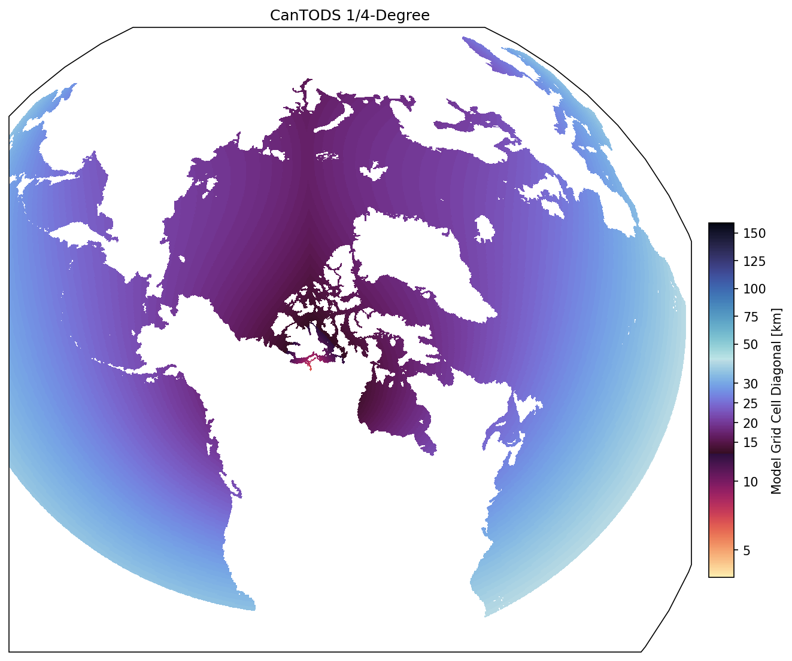
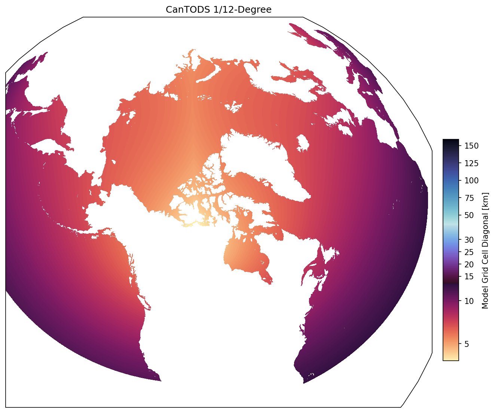

ECCC-CCCMa
===========================

NEMO modelling activities at Environment and Climate Change Canada (ECCC) can be roughly divided into short-term prediction and climate-scale. CONCEPTS (Canadian Operational Network of Coupled Environmental PredicTion Systems) is a partnership between ECCC, Fisheries and Oceans Canada (DFO), and the Department of National Defense (DND) and runs a short-term (10 days) forecast system that covers all of Canada's oceans at 1/12 degree and limited regions at 1/36 degree.

Climate-scale studies are centred at the Canadian Centre for Climate modelling and analysis (CCCma;  `Centre climate modelling analysis - Canada.ca`_). CCCma has been building global Earth System Models with prognostic ocean and land carbon cycles for almost two decades (Christian et al., 2010; Arora et al., 2011). We currently use the global earth system model CanESM (Swart et al., 2019).

CanNEMO is our version of NEMO that we use as the ocean and sea ice component for CanESM which is used for the Climate Model Intercomparison Project (CMIP). CanNEMO is also the ocean component for CCCma’s operational decadal predictions and for 1/2 of the ensemble members included in the Canadian Seasonal and Interannual Prediction System (CanSIPS), which provides seasonal predictions for Canada (the other 1/2 come from successive versions of the ECCC Meteorological Research Division's GEM-NEMO). Presently, we are working to develop the Canadian Three Oceans Downscaling System (CanTODS), a regional ocean domain that will cover Canada’s three oceans (we are starting off from the CONCEPTS Regional Ice Ocean Prediction System (RIOPS) grid), that will be used for climate downscaling as well as for downscaling of seasonal to decadal predictions. 

In addition to our NEMO based physical ocean model, we develop two biogeochemistry models, the Canadian Ocean Ecosystem model (CanOE; Christian et al, 2022), and the Canadian Model of Ocean Carbon (CMOC; Zahariev et al, 2008). 

The most recent published data are from CanESM5 and CanESM5-CanOE (Swart et al., 2019; Christian et al, 2022). CanESM6 is actively under development.

.. _Centre climate modelling analysis - Canada.ca: https://www.canada.ca/en/environment-climate-change/services/climate-change/science-research-data/modeling-projections-analysis/centre-modelling-analysis.html

Model Domains
-----------------
eORCA1: eORCA1 domain and grid size. Grid size is based on the diagonal line through the cell.

.. image:: eORCA1_domaingridsize.png

eORCA025: eORCA025 domain and grid size. Grid size is based on the diagonal line through the cell.

.. image:: eORCA025_domaingridsize.png

Canadian Three Oceans Downscaling System (CanTODS): Our regional ocean domain covering Canada's three oceans for both 1/4 and 1/12 degree resolutions. Presently, open boundaries are located at 32N in the Pacific and 26N in the Atlantic. 

Model Code
----------------
Our model code can be found here: `CCCma / CanESM · GitLab`_

.. _CCCma / CanESM · GitLab: https://gitlab.com/cccma/canesm

Members
-----------------
Jim Christian (biogeochemical modelling)
   * email: jim.christian@ec.gc.ca
   * `Jim Christian publications`_ 
Jonathan Izett (regional modelling)
   * email: jonathan.izett@ec.gc.ca
Nicolas Lambert (global ocean)  
   * email: nicolas.lambert@ec.gc.ca
Bill Merryfield (seasonal to decadal predictions) 
   * email: bill.merryfield@ec.gc.ca
Elise Olson (seasonal to decadal predictions) 
   * email: elise.olson@ec.gc.ca  
Natasha Ridenour (regional modelling)
   * email: natasha.ridenour@ec.gc.ca
   * `Natasha Ridenour's ResearchGate`_ 
   * Natasha is interested in using high resolution regional models to understand oceanic processes in Canadian waters and how these processes might change in a future climate. Her current work focuses on downscaling river discharge from global climate models.
Damien Ringeisen (sea ice) 
   * email: damien.ringeisen@ec.gc.ca
Krysten Rutherford (biogeochemical modelling)
   * email: krysten.rutherford@ec.gc.ca
Geoff Stanley (global ocean)
   * email: geoff.stanley@ec.gc.ca
   * `Geoff Stanley's GitHub`_ 
   * `Geoff Stanley's orcid`_  
Nadja Steiner (biogeochemical modelling) 
   * email: nadja.steiner@ec.gc.ca
Jean Sterlin (global ocean)
   * email: jean.sterlin@ec.gc.ca
Neil Swart (global earth system modelling) 
   * email: neil.swart@ec.gc.ca
Duo Yang (global ocean) 
   * email: duo.yang@ec.gc.ca

.. _Jim Christian publications: https://drive.google.com/file/d/1wnoxY4nKDuC9VeDid-ZC5WJhNErVAe9J/view?usp=sharing
.. _Natasha Ridenour's ResearchGate: https://www.researchgate.net/profile/Natasha-Ridenour
.. _Geoff Stanley's GitHub: https://geoffstanley.github.io/
.. _Geoff Stanley's orcid: https://orcid.org/my-orcid?orcid=0000-0003-4536-8602

Papers
-----------------

Model documenting papers
^^^^^^^^^^^^^^^^^^

* Improvements in the Canadian Earth System Model (CanESM) through systematic model analysis: CanESM5.0 and CanESM5.1 `(Sigmond et al., 2023)`_
* Ocean biogeochemistry in the Canadian Earth System Model version 5.0.3: CanESM5 and CanESM5-CanOE `(Christian et al., 2022)`_
* Decadal climate predictions with the Canadian Earth System Model version 5 (CanESM5) `(Sospedra-Alfonso et al., 2021)`_
* Carbon–concentration and carbon–climate feedbacks in CMIP6 models and their comparison to CMIP5 models `(Arora et al., 2020)`_
* The Canadian Earth System Model version 5 (CanESM5.0.3) `(Swart et al., 2019)`_

.. _(Christian et al., 2022): https://gmd.copernicus.org/articles/15/4393/2022/
.. _(Swart et al., 2019): https://gmd.copernicus.org/articles/12/4823/2019/
.. _(Sigmond et al., 2023): https://gmd.copernicus.org/articles/16/6553/2023/gmd-16-6553-2023.html
.. _(Sospedra-Alfonso et al., 2021): https://gmd.copernicus.org/articles/14/6863/2021/
.. _(Arora et al., 2020): https://bg.copernicus.org/articles/17/4173/2020/

Research papers
^^^^^^^^^^^^^^^^

* Ocean‐Only FAFMIP: Understanding Regional Patterns of Ocean Heat Content and Dynamic Sea Level Change `(Todd et al., 2020)`_
* Impact of Mesoscale Eddy Transfer on Heat Uptake in an Eddy-Parameterizing Ocean Model `(Saenko et al., 2018)`_ 
* Response of the North Atlantic dynamic sea level and circulation to Greenland meltwater and climate change in an eddy-permitting ocean model `(Saenko et al., 2016)`_
* Separating the influence of projected changes in air temperature and wind on patterns of sea level change and ocean heat content `(Saenko et al., 2015)`_
* Role of Resolved and Parameterized Eddies in the Labrador Sea Balance of Heat and Buoyancy `(Saenko et al., 2014)`_
* Ocean Heat Transport and Its Projected Change in CanESM2 `(Yang and Saenko, 2012)`_
* The global carbon cycle in the Canadian Earth system model (CanESM1): Preindustrial control simulation `(Christian et al., 2010)`_ 
* Preindustrial, historical, and fertilization simulations using a global ocean carbon model with new parameterizations of iron limitation, calcification, and N2 fixation `(Zahariev et al., 2008)`_

.. _(Zahariev et al., 2008): https://www.sciencedirect.com/science/article/pii/S0079661108000104?via%3Dihub
.. _(Christian et al., 2010): https://agupubs.onlinelibrary.wiley.com/doi/10.1029/2008JG000920
.. _(Yang and Saenko, 2012): https://journals.ametsoc.org/view/journals/clim/25/23/jcli-d-11-00715.1.xml
.. _(Saenko et al., 2018): https://journals.ametsoc.org/view/journals/clim/31/20/jcli-d-18-0186.1.xml
.. _(Saenko et al., 2016): https://link.springer.com/article/10.1007/s00382-016-3495-7
.. _(Saenko et al., 2015): https://agupubs.onlinelibrary.wiley.com/doi/10.1002/2015JC010928
.. _(Saenko et al., 2014): https://journals.ametsoc.org/view/journals/phoc/44/12/jpo-d-14-0041.1.xml
.. _(Todd et al., 2020): https://agupubs.onlinelibrary.wiley.com/doi/full/10.1029/2019MS002027

References
------------------

Arora, V., J. Scinocca, G. Boer, J. Christian, K. Denman, G. Flato, V. Kharin, W. Lee, and W. Merryfield (2011), Carbon emission limits required to satisfy future representative concentration pathways of greenhouse gases, Geophysical Research Letters, 38, doi:10.1029/2010GL046270.

Christian, J., et al. (2010), The global carbon cycle in the Canadian Earth system model (CanESM1): Preindustrial control simulation, Journal of Geophysical Research-Biogeosciences, 115, doi:10.1029/2008JG000920.

Christian, J. R., K. L. Denman, H. Hayashida, A. M. Holdsworth, W. G. Lee, O. G. J. Riche, A. E. Shao, N. Steiner, and N. C. Swart (2022), Ocean biogeochemistry in the Canadian Earth System Model version 5.0.3: CanESM5 and CanESM5-CanOE, Geoscientific Model Development, 15(11), doi:10.5194/gmd-15-4393-2022.

Swart, N., et al. (2019), The Canadian Earth System Model version 5 (CanESM5.0.3), Geoscientific Model Development, 12(11), 4823-4873, doi:10.5194/gmd-12-4823-2019.

Zahariev, K., J. Christian, and K. Denman (2008), Preindustrial, historical, and fertilization simulations using a global ocean carbon model with new parameterizations of iron limitation, calcification, and N-2 fixation, Progress in Oceanography, 77(1), 56-82, doi:10.1016/j.pocean.2008.01.007.

